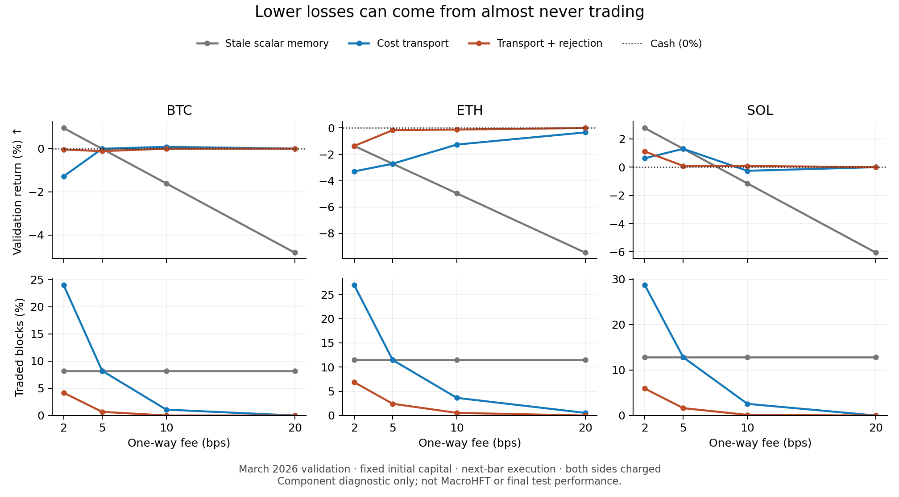

# Pilot outcome and research decision

Client date: 2026-10-14. Status: diagnostic completed; research contribution NOT established.

## 中文结论

已完成 BTC、ETH、SOL 三个市场、四档单边手续费和七种组件/控制策略，共 84 个验证设置。数据来自 Binance 官方月度文件，九个下载均校验 SHA256；没有下载或评估保留测试月份。六项因果性及会计测试通过。

这轮结果不支持把“成本重估＋距离拒绝”直接作为新的顶会方法。高费用下损失下降主要伴随交易活动接近零；低费用时，成本迁移也可能比原始固定标签更差。不能把规避交易造成的低回撤包装为预测能力或策略质量提升。

## Nominal 5 bps validation measurements

| Asset | Component | Return (%) ↑ | Drawdown (%) ↓ | Participation (%) |
| --- | --- | ---: | ---: | ---: |
| BTCUSDT | cash | 0.0000 | 0.0000 | 0.00 |
| BTCUSDT | scalar_memory | -0.0066 | 1.9477 | 8.22 |
| BTCUSDT | transport_memory | -0.0066 | 1.9477 | 8.22 |
| BTCUSDT | guarded_transport | -0.1162 | 0.3684 | 0.67 |
| ETHUSDT | cash | 0.0000 | 0.0000 | 0.00 |
| ETHUSDT | scalar_memory | -2.7136 | 3.7585 | 11.46 |
| ETHUSDT | transport_memory | -2.7136 | 3.7585 | 11.46 |
| ETHUSDT | guarded_transport | -0.1641 | 0.9384 | 2.43 |
| SOLUSDT | cash | 0.0000 | 0.0000 | 0.00 |
| SOLUSDT | scalar_memory | 1.3012 | 1.4197 | 12.80 |
| SOLUSDT | transport_memory | 1.3012 | 1.4197 | 12.80 |
| SOLUSDT | guarded_transport | 0.0887 | 0.7376 | 1.62 |

## English interpretation

The decomposition passes exact-accounting checks but does not establish predictive skill or novel methodology. At the nominal fee, transport and scalar memory are identical by construction. The guarded method trades only 0.67%, 2.43% and 1.62% of BTC, ETH and SOL blocks, respectively. At 20 bps it holds cash on every asset. At 2 bps, mean returns across these three independent validation scenarios are approximately +0.789% for stale scalar memory and −1.318% for transported memory. These are descriptive averages, not a portfolio result or significance test. Do not select the more favorable fee after seeing these results.

The pilot uses 60-minute flat/long round trips, eight causal minute-bar features and a frozen nearest-neighbor memory. It has no learned MacroHFT experts, no deep RL training and no calibrated execution impact. Its denominator, dates and policy class differ from the original benchmark: no comparison with 39.28% is valid. Multi-asset market observations are correlated; three symbols in one month are not independent replications.

## Decision

Do not promote this component as a CCF A contribution. Retain the causal/accounting infrastructure and negative results. The next discriminating study must separate state-support failure, conditional-return drift, and cost-label mismatch, and compare activity-matched controls. A stronger integrated RL mechanism and an independent theoretical/novelty audit are required before expensive sweeps or a finished manuscript.

Remote historical test results remain UNKNOWN because c225/c220ts timed out. Restore connectivity before reconciling the original three-seed comparison. No new remote job or paid rental was launched.

## Reproducibility

Registered protocol: `protocol.json`; source: `src/memory.py`; runner: `scripts/pilot.py`; six tests: `tests/test_core.py`; complete outcomes: `results/pilot.json` and `results/pilot.csv`; data checksums: `results/data-manifest.json`; code hashes: `results/execution-manifest.json`. Report regeneration: `../../.venv/bin/python scripts/report.py` from this route root.

Raw archive bytes: 17852203. Total raw rows: 388800. Pilot elapsed seconds: 77.59.

## Activity-matched diagnostic (post-hoc)

After inspecting the primary pilot, we registered 500 random schedules per asset/cost with the same number of selected blocks as the guarded component, seed 1973. All 12 settings are retained in results/activity-control.json. Exact original guarded returns were reproduced before comparison. This is a hindsight activity-matched diagnostic, not a deployed benchmark or calibrated p-value. At 5 bps the guarded return lies inside the random-schedule 5th to 95th percentile range on all three assets. At 20 bps all schedules are identically cash. A compelling advantage over equally sparse trading is not established.

中文：补充了同交易次数的随机时点对照。三市场的组件收益都落在随机对照区间内，不能证明稳定选时优势。这是事后诊断，不是正式显著性检验。
